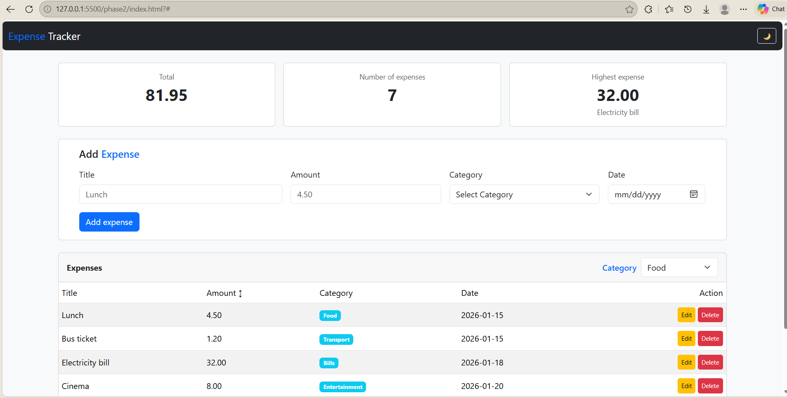
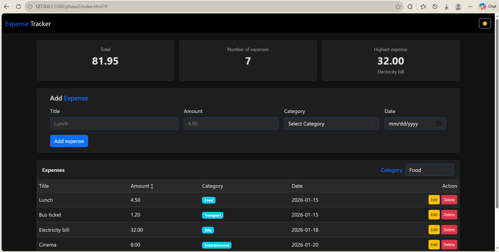
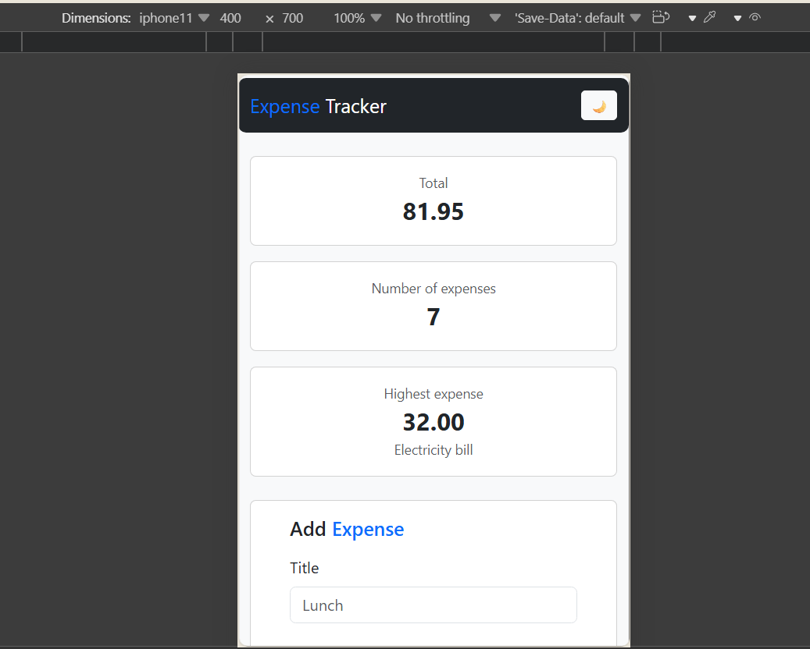
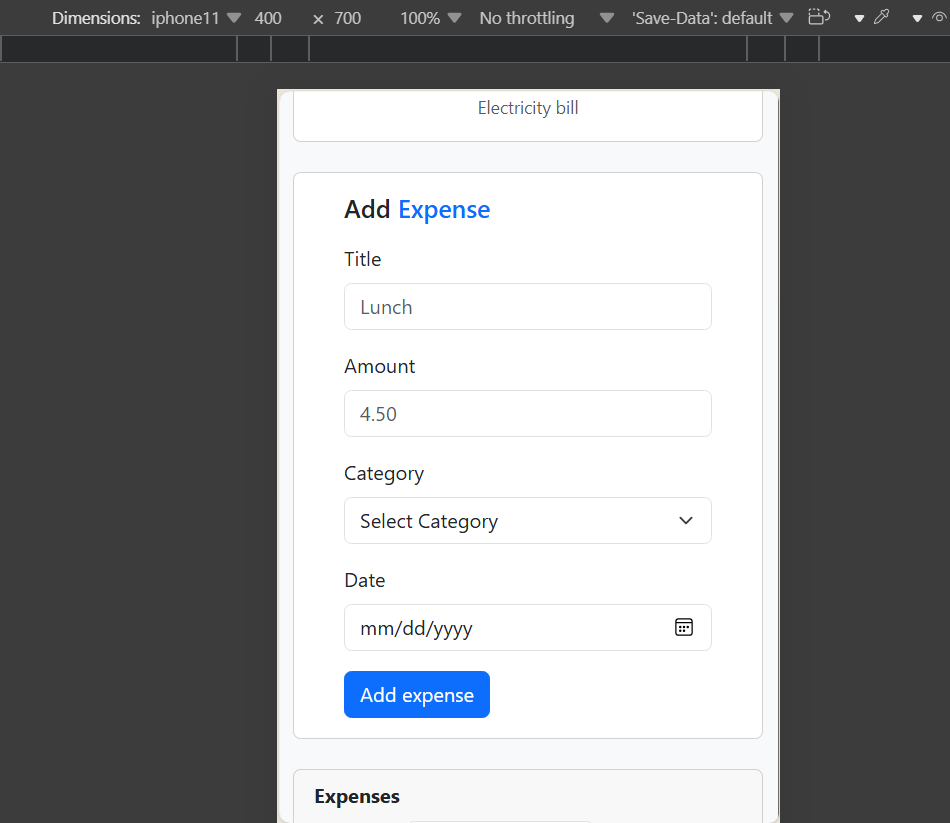
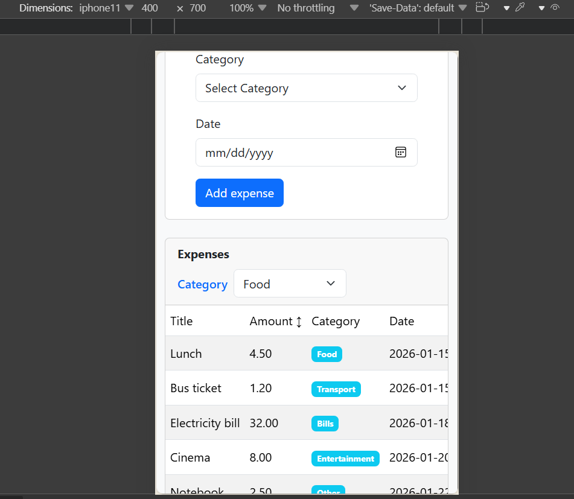

# Expense Tracker

A personal expense tracker web app with full CRUD operations, built with Node.js, Express, and PostgreSQL.

---

## Features

- Add a new expense (title, amount, category, date)
- View all expenses in a table
- Edit an expense in a modal
- Delete an expense
- Filter expenses by category
- Sort expenses by amount (ascending / descending)
- Dark mode with saved preference
- Responsive design for mobile and desktop
- Loading spinner and error alerts

---

## Tech Stack

**Frontend:**
- HTML5
- CSS3 + Bootstrap 5
- Vanilla JavaScript (fetch, async/await)

**Backend:**
- Node.js
- Express
- cors, dotenv

**Database:**
- PostgreSQL
- pg (node-postgres)

---

## Project Structure
```
expense-tracker/
├── frontend/
│   ├── index.html
│   ├── css/
│   │   └── style.css
│   └── js/
│       └── app.js
├── backend/
│   ├── server.js
│   ├── package.json
│   ├── schema.sql
│   └── .env.example
└── README.md
```

## Setup Instructions

### 1- Database

1. Open **pgAdmin** and connect to your PostgreSQL server.
2. Create a new database named `expense_tracker`.
3. Open the **Query Tool** on that database.
4. Copy the contents of `backend/schema.sql` and run it.
5. This will create the `expenses` table and add sample data.

### 2- Backend

```bash
cd backend
npm install
```
Copy .env.example to a new file named .env and fill in your PostgreSQL password:

```
DB_HOST=localhost
DB_PORT=5432
DB_USER=postgres
DB_PASSWORD=your_password_here
DB_NAME=expense_tracker
```

```bash
node server.js
```
The server runs at http://localhost:3000.

### 3- Frontend
Open frontend/index.html with Live Server (VS Code extension).

Make sure the backend server is running.

## API Endpoints
Method	Endpoint	Description
GET	/api/expenses	Get all expenses
GET	/api/expenses/:id	Get one expense
POST	/api/expenses	Add a new expense
PUT	/api/expenses/:id	Update an expense
DELETE	/api/expenses/:id	Delete an expense

## Screenshots
## Light Mode

## Dark Mode

### Mobile View




### Challenges
The hardest part was connecting the frontend to the backend using fetch and handling CORS errors. I learned how to enable CORS on the server with the cors package, and how to use async/await with try/catch to handle errors gracefully.

### Edit Modal
Another challenge was the edit modal — making sure the form was populated with the correct data and sending a proper PUT request with the updated values.

## Author
**Wiam Shalash** — 2026